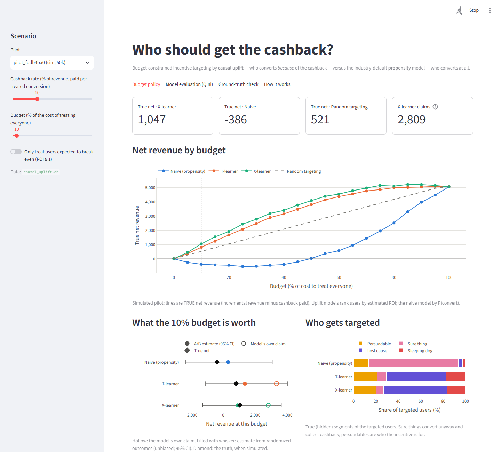
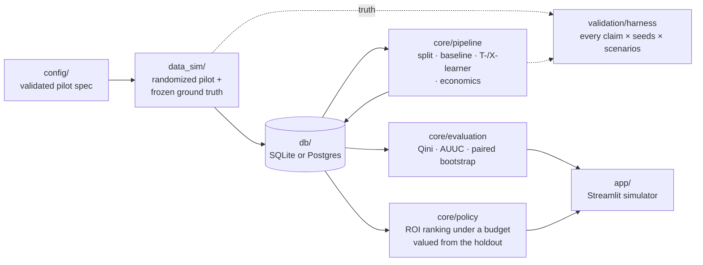
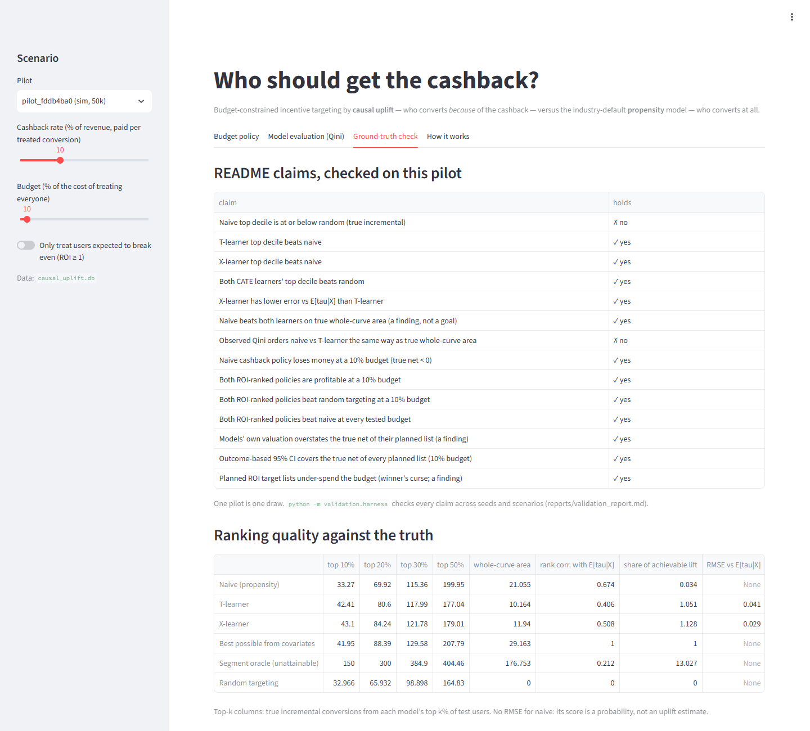

# Causal Uplift Targeting

[](https://github.com/tarun-rai21/causal-uplift-targeting/actions/workflows/ci.yml)
[](https://causal-uplift-targeting.streamlit.app/)

**Who should get the cashback?** This project targets an incentive at the people who
convert *because of* it, not at the people who would have converted anyway. It then
proves, against known ground truth, how much that is worth and where it stops working.

**[Try the live demo →](https://causal-uplift-targeting.streamlit.app/)** Vary the budget and cashback rate and see who each model
targets and what that is really worth. If the app has been asleep, the first load
rebuilds the demo pilot, which takes a couple of minutes.



## The result in four numbers

At a 10% budget, with cashback at 10% of revenue, means over 5 simulator seeds
([full report](reports/validation_report.md)):

| Targeting policy | True net revenue |
|---|---|
| **Naive**: target the most likely to convert | **−364**: loses money, in every seed |
| Random targeting | +471 |
| **T-learner**, ranked by estimated ROI | **+849** |
| **X-learner**, ranked by estimated ROI | **+871** |
| Best ranking possible from the observable data | +1,343 |

The models' *own* estimate of the T-learner list's value is **3,010**. Its true value is
**736**. That gap is why every number in this project is checked against the truth
instead of taken from the model.

## The problem

Standard practice ranks customers by predicted probability of converting and gives the
incentive to the top of the list. Under a cashback that is paid on **every treated
conversion**, that list is full of the wrong people:

| Segment (hidden from every model) | Converts without cashback | Effect of the cashback |
|---|---|---|
| **Persuadable** | rarely (8%) | **+15 pts**: who the incentive is for |
| **Sure thing** | often (40%) | +1 pt, yet they collect the cashback |
| **Lost cause** | almost never (2%) | none |
| **Sleeping dog** | sometimes (15%) | **−5 pts**: the offer puts them off |

The quantity that matters is the conditional average treatment effect (CATE),
τ(x) = E[Y(1) − Y(0) | X = x]: the conversion the incentive itself causes. Ranking by
P(convert) instead puts sure-things first. In this simulator, 72% of the naive top decile
are sure-things.

## How it works



1. **Simulate a randomized pilot** with known per-segment effects, segment-dependent
   revenue, and covariates that *overlap* across segments. The segment itself is never
   a feature.
2. **Estimate uplift.** The T-learner fits P(convert) separately per arm and subtracts.
   The X-learner imputes each user's effect from the other arm's model, then
   combines the two estimates weighted by the known assignment probability. Both are
   hand-implemented on the same gradient-boosting base learner as the naive baseline, so
   differences come from the estimand, not model capacity.
3. **Evaluate without the truth.** Qini curves, the Qini coefficient and AUUC, matched
   exactly against `causalml`. A paired bootstrap gives a confidence interval for every
   score and every model-vs-model difference.
4. **Decide under a budget.** Treating user i costs rate × p₁(x) × m(x) in cashback
   (p₁ = P(convert | treated), m = revenue per conversion) and earns τ(x) × m(x).
   Users are ranked by **ROI = τ / (rate × p₁)** and targeted down the list until the
   budget is spent.
5. **Value it honestly.** Models choose *who* to target. The randomized holdout says
   *what it's worth*: within the targeted users, compare treated and control revenue.
6. **Validate everything against the truth**, across 5 seeds × 2 scenarios (balanced 50/50
   and imbalanced 20/80 treatment), reporting each claim as "holds in k/n runs".

## Findings

All numbers are 5-seed means on 10,000 held-out users per run. "Top decile" means
targeting the 10% with the highest score. Full per-seed tables are in
[`reports/validation_report.md`](reports/validation_report.md).

**1. Naive targeting fails exactly where budgets bite.** On true incremental conversions
from the top decile, naive scores 29.9 against random's 32.4: at or below random in 5/5
seeds. The T-learner scores 39.0 and the X-learner 36.4, both beating naive in 5/5 seeds.
The T-learner captures 63% of the lift that is achievable from the observable data
(ceiling 42.7).

**2. ...but not over the whole ranking.** On true whole-curve area, naive (19.1) beats
the T-learner (9.6) and the X-learner (11.1) in 5/5 seeds. Rank correlation with the true
E[τ|X] agrees: naive 0.67 vs 0.29 and 0.38. Conversion propensity tracks spend, and spend
is a decent proxy for uplift everywhere except the very top, where the sure-things sit.
*Which model is better depends on the budget*, which is the decision the policy layer
makes.

**3. A better estimator is not automatically a better targeter.** The X-learner has
lower error against E[τ|X] than the T-learner in 10/10 runs (RMSE 0.027 vs 0.039). But it
wins top-decile targeting only when treatment is imbalanced (4/5 at 20/80; it loses 4/5
at 50/50): its second-stage regression smooths the top of the ranking.

**4. Under cashback, naive targeting loses money; ROI ranking doesn't.** Naive's true net
at a 10% budget is negative in 10/10 runs, and its average is negative at every tested
budget (5–50%), which is worse than targeting at random. Both ROI-ranked policies are
profitable at 10% and beat naive at every tested budget, in 10/10 runs.

**5. Models overstate their own policies about 4×.** Summing a model's estimated uplift
over the users *it selected* inherits that selection: a winner's curse (5/5 seeds, both
scenarios). The same noise inflates selected users' estimated costs, so target lists
fixed in advance under-spend (only 68% of budget for the T-learner at 20/80). Pacing on
realized cashback recovers the shortfall.

**6. Honest valuation is calibrated but data-hungry.** On the held-out users, the 95%
interval for a policy's net covers the truth at about the nominal rate. But it is roughly
±2,500 wide around true values of a few hundred, and Qini intervals (about ±20) are
wider than the gaps between trained models. Observed Qini ranked naive vs T-learner the
wrong way in 7 of 10 runs. A 10k-user holdout cannot separate close policies, which is
why the simulator is where the policy logic is proven.



## Running it

Requires Python 3.12+.

```bash
pip install -r requirements-dev.txt    # or `pip install .` to install it as a package

python -m db.seed             # simulate a 50k-user pilot into ./causal_uplift.db (or $DATABASE_URL;
                              #   also read from a .env file); --config PATH for another pilot spec
python -m core.pipeline       # split it, train baseline + T/X-learner + economics, store test-set predictions
python -m core.evaluation     # Qini / AUUC with paired-bootstrap CIs
python -m core.policy         # budget curves: who to target, valued from the holdout
streamlit run app/streamlit_app.py   # the interactive simulator above

python -m validation.harness --out reports/validation_report.md   # ~2 min, all claims × seeds × scenarios
python -m validation.harness --pilot-id <id>                       # one stored pilot vs its stored truth

pytest -m "not slow"          # fast suite (what CI runs)
pytest -m slow -s             # statistical validation against ground truth
```

`pip install -r requirements-validation.txt` also enables the exact cross-check against
`causalml`. That test is skipped otherwise, which keeps CI light.

### Deploying the app (Streamlit Community Cloud)

1. At [share.streamlit.io](https://share.streamlit.io), create an app from this repo:
   branch `main`, main file `app/streamlit_app.py`.
2. Under **Advanced settings**, choose **Python 3.12**. Under **Secrets**, add
   `UPLIFT_AUTO_DEMO = "1"`.
3. Deploy. The cloud filesystem starts empty, so the first visit builds the demo pilot
   in-process: it simulates 50,000 users, trains, and evaluates, taking about 1.5 minutes
   locally. A lock makes sure concurrent visitors don't trigger a second build. Later
   visits are instant until the app restarts. Without the secret, the page offers a
   button for the same build.

## Project layout

| Path | What it does |
|---|---|
| `config/` | Pydantic-validated pilot spec: segment mix, effects, baselines, revenue; unknown keys are rejected |
| `data_sim/` | Pilot simulator and `GroundTruth`: per-segment truth, E[τ\|X], covariate-level economics |
| `db/` | Schema (SQLite / Postgres-portable, foreign keys enforced), connection, seeding |
| `core/data_split.py` | Train/test split stratified on (treated, converted), stored so every model uses the same holdout |
| `core/baseline.py` | Naive P(convert) model, kept on purpose as the wrong-answer contrast |
| `core/t_learner.py`, `core/x_learner.py` | Hand-implemented meta-learners on a shared base learner (`core/learners.py`) |
| `core/economics.py` | Shared P(convert \| treated) and revenue-per-conversion estimates for costing |
| `core/evaluation.py` | Qini, AUUC, paired bootstrap; persisted curves and scores |
| `core/policy.py` | Budget-constrained ROI targeting, outcome-based valuation; no modeling logic |
| `core/pipeline.py` | Database → split → train → store, as one command |
| `validation/` | Oracle evaluation, the multi-seed harness, and the slow statistical tests |
| `app/` | Streamlit simulator: presentation only, every number comes from the modules above |
| `reports/` | The standing validation report, stamped with the commit that produced it |

## Testing

- **Fast suite (CI on Python 3.12):** 117 tests. They cover the simulator, closed-form
  tests of each learner's arithmetic with deterministic stand-in models, the exact
  `causalml` cross-check, and database round-trips with foreign keys enforced.
- **End to end:** one test runs every real entrypoint as its own process, from seed
  through pipeline, evaluation, policy and validation to the app, against one database
  and from an unrelated working directory. After each stage it checks the database
  state the next stage depends on, so a broken contract between stages fails even when
  each stage's own tests pass.
- **App and pipeline tests:** Streamlit `AppTest` runs the full page against a freshly
  seeded and trained database. A pipeline test proves the database path gives
  bit-identical predictions to training in memory.
- **Slow suite:** 8 statistical tests. They assert only the claims that held in *every*
  run of the harness; claims that held in fewer runs are reported, not asserted, so the
  suite does not encode luck.

## Limitations

- **Simulated data.** Every conclusion holds for this simulator's design and is not a
  claim about any real market. Only `historical_spend` carries segment signal (region,
  device and signup date are noise), and effects are constant within a segment.
- **The incentive changes whether someone converts, never basket size.** Revenue per
  conversion does not depend on treatment. On real data that should be checked, and the
  revenue model fitted on treated converters if it fails.
- **One period, no interference.** Users don't affect each other (SUTVA), and cashback
  is the only cost.
- **Untuned base learners.** Default gradient boosting, with no hyperparameter search
  or probability calibration.
- **Underpowered holdout.** As finding 6 says, outcome-based validation on 10k users
  cannot separate close models or policies. A real deployment needs much larger
  holdouts, or pooled pilots.

## FAQ

**Why not just predict who will convert?** Because cashback is paid to everyone treated
who converts, including people who would have converted anyway. In the simulator, the
naive model's top decile is 72% sure-things, and its cashback policy loses money at every
budget tested.

**Why simulate instead of using a public dataset?** Individual treatment effects are
never observed in real data, so "the model recovered the true uplift" can't be checked
there. The simulator stores its truth, so every claim is a test, not an assertion. The
price is that results depend on the simulator's design, so the README states that design
openly.

**Why T- and X-learners rather than a causal forest or a DR-learner?** Implementing them
by hand on the same base learner keeps the mechanism visible and the comparison fair.
The X-learner is the textbook answer to the T-learner's weakness under imbalanced
treatment, and the harness shows both where that holds (estimation error) and where it
doesn't (top-decile targeting at 50/50). A doubly robust learner is a natural next
addition.

**Why rank by ROI instead of by uplift?** Under a spend cap, the best order is
incremental revenue per unit of cashback: the greedy knapsack order. Revenue per
conversion cancels out of it. Ranking by plain uplift or by net value did worse at every
constrained budget tested, because both spend heavily on sure-things.

**Why not report the model's expected revenue?** Because it is inflated by selection.
The model picks users whose estimated uplift is high, partly because of noise, so
summing those estimates overstates the gain about 4×. The holdout estimate is unbiased.

**If Qini can't tell the models apart, is it useless?** No. It is unbiased, and on a
250k-user pilot it ranks targeting rules in the same order as the truth (a slow test).
It just needs far more data than an oracle does. Report its interval, not a point
ranking.

**What would production need?** Real pilot data in place of the simulator (the pipeline
already reads from the database), Postgres via `DATABASE_URL`, spend pacing on realized
cashback, scheduled retraining, and monitoring of holdout-based value over time.

## Status

| Phase | Scope | |
|---|---|---|
| 0–1.5 | Environment and CI, validated config, simulator with ground truth, persisted split | ✅ |
| 2–4 | Naive baseline and its failure proof, T-learner, X-learner | ✅ |
| 5 | Qini / AUUC with paired bootstrap CIs, cross-checked against `causalml` | ✅ |
| 6 | Multi-seed ground-truth validation harness and standing report | ✅ |
| 7 | Segment revenue, cashback economics, budget-constrained ROI policy | ✅ |
| 9 | Streamlit policy simulator and this write-up | ✅ |
| 10 | End-to-end test through every real entrypoint; packaging and cleanups | ✅ |
| 8 | FastAPI service layer (optional) | not built |

## License

[MIT](LICENSE).
