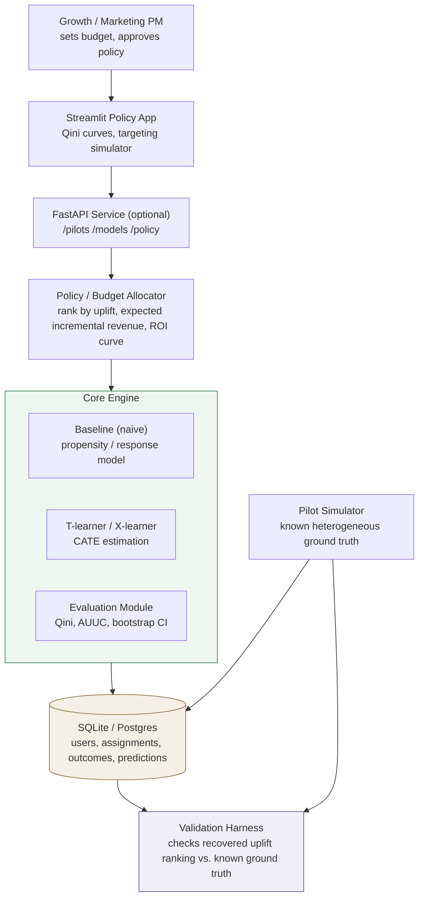

# Causal Uplift Targeting

Uplift modeling system for budget-constrained incentive targeting.

## The problem

Standard practice targets incentives (discounts, cashback, fee waivers) at customers with
the highest predicted probability of converting. This is the wrong quantity: it targets
"sure things" who would have converted anyway, and misses "persuadables" who convert
*only because* of the incentive. The right quantity is the conditional average treatment
effect (CATE) — the incremental probability of conversion the incentive itself causes —
not the raw conversion probability.

This project builds that estimation pipeline end to end, on simulated pilot data with
known ground-truth heterogeneity, so every claim it makes is checkable rather than
asserted.

## Status

🚧 **Under active development.** This README will be replaced with full results
(validation numbers, Qini comparisons, screenshots, FAQ) once the pipeline is built and
validated. Currently in early scaffolding — see the roadmap below.

## Running it

Requires Python 3.12+ (`pip install -r requirements-dev.txt`). From the repo root:

```bash
python -m db.seed          # simulate a pilot into ./causal_uplift.db (or $DATABASE_URL)
python -m core.pipeline    # split it, train baseline + T/X-learner, persist test-set predictions
python -m core.evaluation  # Qini / AUUC with paired bootstrap CIs; persists curves + scores
python -m validation.harness --out reports/validation_report.md
                           # multi-seed ground-truth validation of every model and claim
python -m validation.harness --pilot-id <id>   # validate a stored pilot vs its stored truth
python -m core.policy --cashback-rate 0.1      # budget curves: who to target, valued from outcomes
streamlit run app/streamlit_app.py             # interactive policy simulator over the stored pilots
pytest -m "not slow"       # fast suite (what CI runs)
pytest -m slow -s          # statistical validation against simulator ground truth
```

`pip install -r requirements-validation.txt` additionally enables the exact
cross-check against `causalml` (skipped otherwise).

## Findings so far

Generated by the validation harness; full per-seed numbers in
[`reports/validation_report.md`](reports/validation_report.md). On the default simulator
(top-decile = targeting the 10% with the highest score):

- **Naive targeting fails where budgets bite.** Its top decile is 72% sure-things and
  lands at or below random on true incremental conversions (5/5 seeds).
- **CATE learners win at the top.** The T-learner's top decile beats the baseline in 5/5
  seeds and captures ~60% of the lift achievable from observable covariates.
- **But not over the whole ranking.** On true whole-curve area the naive baseline beats
  both learners (5/5 seeds): ranking by conversion propensity tracks spend, which is a
  decent proxy for uplift everywhere except the very top. Which model is "better"
  depends on the budget -- exactly what the Phase 7 policy layer has to decide.
- **The X-learner estimates better, but doesn't always target better.** It had lower
  error than the T-learner in 10/10 runs, but won top-decile targeting only under an
  imbalanced pilot (4/5 at e=0.2, lost 4/5 at e=0.5).
- **Under a cashback incentive, naive targeting loses money.** Paying cashback on every
  treated conversion makes sure-things expensive (they convert anyway), so the naive
  policy's true net is negative at every tested budget (5/5 seeds, both scenarios) --
  worse than targeting at random. Ranking by estimated ROI, tau / (rate x P(convert |
  treated)), is profitable and beats naive at every budget in every run.
- **Models overstate their own policies ~4x.** A model's sum of estimated uplift over the
  users it selected is inflated by that selection (winner's curse). The same noise also
  inflates selected users' estimated costs, so fixed target lists under-spend; pacing
  spend on realized cashback recovers the shortfall. Honest valuation comes from the
  randomized holdout: its 95% intervals cover the truth at about the nominal rate, but
  are roughly +/-2,500 around true nets of a few hundred -- a 10k-user holdout cannot
  tell a profitable cashback policy from a losing one.
- **Qini needs much more data than the oracle.** On a 10k-user test set its intervals
  (about +/-20) are wider than the real gaps between trained models; it recovers the
  true ordering of targeting rules reliably only at a few hundred thousand users.

## Planned architecture

- **Data layer**: configurable pilot simulator with known per-segment treatment effects
  (persuadables, sure-things, lost-causes), relational storage (SQLite/Postgres-portable)
- **Core engine**: naive propensity baseline (kept permanently as a documented wrong-answer
  contrast), T-learner and X-learner meta-learners hand-implemented on scikit-learn base
  learners
- **Evaluation**: Qini curve / Qini coefficient / AUUC, cross-checked against `causalml`,
  with bootstrap confidence intervals
- **Policy layer**: budget-constrained targeting with expected incremental revenue and a
  marginal-ROI (diminishing returns) curve
- **Validation harness**: proves — not asserts — against known simulator ground truth that,
  at budget-constrained targeting depths (the top of the ranking), naive targeting fails to
  beat random and uplift modeling beats both; and reports where those claims stop holding
  (over the whole ranking, naive beats random and even the CATE learners — see Findings)
- **Apps**: Streamlit interactive policy simulator; optional FastAPI service layer

## Architecture



The policy layer is deliberately separated from the core engine: it consumes model
output (predicted uplift per user) but contains no modeling logic itself, so the budget
objective can be swapped (e.g., maximize revenue vs. maximize conversions vs. a
minimum-ROI floor) without touching any causal estimation code. The validation harness
sits outside the request path entirely — it's a standing proof against the simulator's
known ground truth, not something invoked per user request.

## Roadmap

| Phase | Scope |
|---|---|
| 0 | Environment, repo scaffold, config validation |
| 1 | Pilot simulator with heterogeneous ground truth |
| 1.5 | Train/test split module |
| 2 | Baseline propensity model + naive-vs-random failure proof |
| 3 | T-learner |
| 4 | X-learner |
| 5 | Evaluation module (Qini/AUUC/bootstrap CI) |
| 6 | Ground-truth validation harness |
| 7 | Policy / budget allocation module |
| 8 | API layer (optional) |
| 9 | Streamlit app + portfolio writeup |
| 10 | End-to-end integration tests |

## Why this exists

This is a portfolio project demonstrating causal-inference-based targeting as distinct
from standard propensity/response modeling — the gap between "who will convert" and
"who converts *because of* the intervention," and why that gap has real budget
consequences.

## License

TBD.